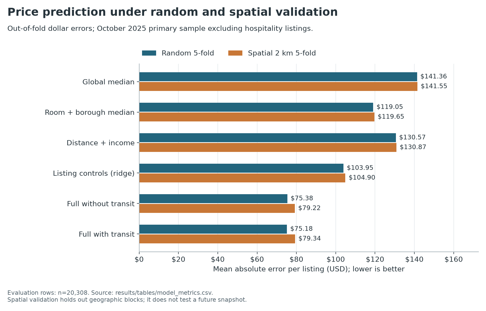

# NYC Airbnb Asking Prices and Subway Access

A reproducible geospatial analysis of advertised nightly Airbnb prices, subway accessibility, and neighborhood context in New York City. This extends the original DSCI 510 coursework with source validation, semantic sample selection, model baselines, geographic cross-validation, and uncertainty estimates.

## Results

The October 2025 source contains **36,111 listings**. Of these, 21,326 have valid positive prices and match NYC tracts. The primary sample contains **20,308 non-hotel listings**, excluding 1,018 records identified as hotels, hostels, or resorts by room/property type. No price-tail trimming is applied. The median minimum stay is 30 nights, so this is not exclusively a short-stay market.

- Six candidate models were evaluated on identical five-fold splits. In **2 km spatial group cross-validation**, the model with listing and neighborhood features achieved **MAE $79.22/night**, compared with **$119.65** for a room-type/borough median baseline, a **33.8% reduction**. Median absolute error is $31.32; log1p-price R² is 0.742. Dollar RMSE remains $545.23, reflecting retained extreme asking prices.
- Adding transit features to a model already using coordinates did **not** reduce spatial-validation MAE ($79.34 versus $79.22).
- On 14,001 common complete cases, the adjusted association per 500 m farther from subway changes from -3.07% in the distance/income model to **+0.80%** with neighborhood fixed effects, with a **95% tract-clustered interval [-0.87%, 2.49%]**. The interval spans zero; this does not establish a transit price premium or causal effect.
- **71.6%** of primary listings are within 500 m straight-line distance of a subway station. Coordinates are approximate, and this is not walking distance.



Read the [executed results notebook](notebooks/portfolio_results.ipynb), [written findings and limits](docs/RESULTS.md), or download/open the [standalone notebook HTML](results/portfolio_results.html). The [interactive map](results/nyc_airbnb_map.html) must be downloaded/opened locally; GitHub's file viewer does not execute it. [Chinese project and resume notes](docs/PROJECT_GUIDE_ZH.md) provide interview-ready wording.

## Reproduce

Tested with **Python 3.12**. Run from the repository root:

```bash
python -m venv .venv
# Windows: .venv\Scripts\activate
# macOS/Linux: source .venv/bin/activate
python -m pip install -r requirements.txt
python src/run_analysis.py
python -m unittest discover -s tests -v
python scripts/execute_notebook.py
```

The first analysis run downloads the exact historical Inside Airbnb and Census files once, verifies pinned SHA256 hashes, and caches them in `data/raw/`. The original MTA extract is bundled in `data/reference/`. No Census API key is required. Historical archive availability can expire: if unavailable, restore the exact original cache rather than silently changing snapshots.

Subsequent reruns can use `python src/run_analysis.py --offline`. `--prepare-only` validates inputs and builds features without training. The compatibility command `python src/main.py` uses the same pipeline. `requirements-lock.txt` records the full environment; `requirements.txt` pins direct dependencies.

The notebook is an executed review companion to the pipeline, rather than a second training implementation. Its generated HTML contains embedded figure outputs and can be read offline. Interactive map tiles and Leaflet assets require internet.

## Data and methods

- **Airbnb:** exact `2025-10-01` archive, listing scrape dates October 1–2, 2025.
- **Subway:** 472 unique non-SIR station locations from the frozen original MTA extract; publication/download date unknown.
- **Neighborhoods:** 2,327 NYC TIGER/Line 2023 census tracts, with ACS 2019–2023 median household income, income margins of error, population, and land-area density.
- **Spatial features:** EPSG:32618 distances, nearest station, unique stations within 800 m, one-to-one point-in-polygon tract joins, and 2 km geographic groups.
- **Prediction:** global and room/borough medians, distance/income ridge, listing-controls ridge, and two histogram gradient-boosting models with/without transit. Imputation, scaling, and encoding are fitted within training folds. Targets are `log1p(price)`; dollar errors use inverse-transformed held-out predictions. Fixed parameters, no hyperparameter search or separate final deployment test.
- **Association:** natural-log-price OLS with progressively richer controls and tract-clustered 95% intervals; first three specifications share complete cases. Fixed effects use borough × recorded neighborhood, absorbing borough effects. Restricted-distance and price-tail sensitivities are reported separately.

The accommodation scope was refined after inspecting source price anomalies, before rerunning the primary models. Full-catalog benchmarks remain visible. The same exploratory dataset informed project development, so validation is an internal comparison, not an untouched external evaluation.

## Repository guide

```text
src/nyc_airbnb/       ingestion, geospatial features, models, figures, scope rule
src/run_analysis.py  complete deterministic pipeline
tests/               geospatial, cleaning, isolation, and metric checks
data/reference/      frozen MTA input; third-party source terms apply
results/tables/      aggregate primary and full-catalog benchmarks
results/             source manifest, data-quality report, metrics, map, notebook HTML
figures/             four reproducible figures
notebooks/           executed analytical companion
docs/                sources, findings, methods, Chinese resume/interview guide
archive/coursework/  preserved original source and notebook
```

Raw listing caches, derived listing-level data and predictions are ignored by Git. Aggregate tables, figures, hashes and the executed notebook are included. The original course PDFs under `doc/` are historical and their old metrics should not be used as verified portfolio results.

## Interpretation and limitations

Advertised prices are not booked rates, property sale values, revenue or occupancy. Missing prices exclude 14,783 source rows. ACS is lagged area context, and listing coordinates may be displaced by approximately 150 m. Adjacent spatial cells can touch and hosts can appear across folds; validation does not establish future-period or host-independent performance. Residual spatial autocorrelation remains. No causal or realized business-impact claims are made.

See [data provenance and licenses](docs/DATA_SOURCES.md). Code is MIT licensed; third-party data retains its publisher's terms.
