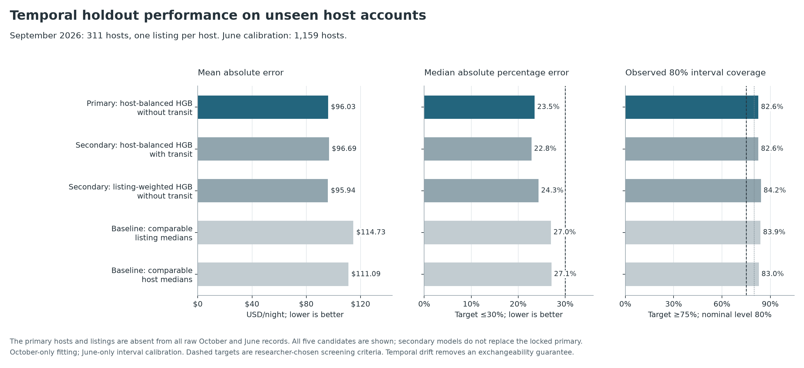
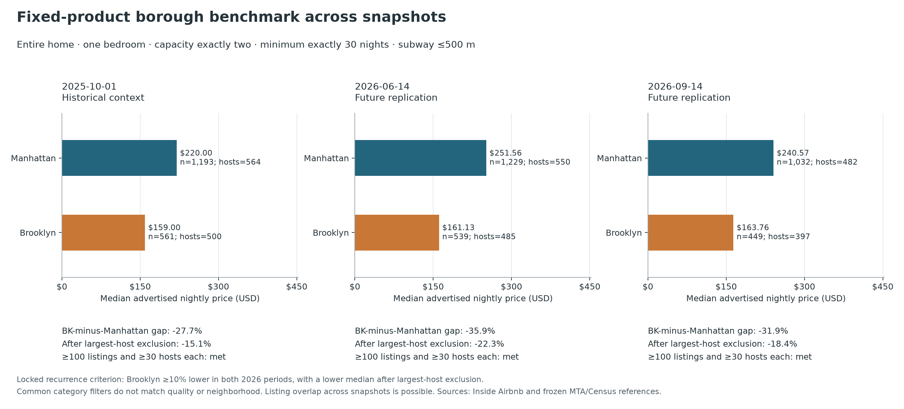

# 按锁定规则完成的时间外验证结论

**主模型通过了全部预先锁定的离线筛选标准。** 主测试集为 2026 年 9 月的 **311 个房东账号，各取一条房源**；这些账号和房源 ID 均未出现在 2025 年 10 月及 2026 年 6 月的全部原始记录中。6 月仅用于区间校准，样本为 1,159 个新账号。测试集只比事先设定的 300 个账号门槛多 11 个，不能据此声称所有地区、房型或未来时期都同样可靠。

验证方案在下载未来快照前已锁定，commit 为 `b75e5a69daf625312ca2a4c582d3ddbf36657447`，见 [完整方案](TEMPORAL_EVALUATION_PROTOCOL.md)。这是有预设规则的回顾性留出验证，不是注册实验，也不是因果识别。

## 1. 模型检验得到什么

主模型是按账号平衡权重训练的直方图梯度提升模型，MAE 为 **$96.03/晚**；绝对误差中位数 **$32.42**，绝对百分比误差中位数 **23.5%**。**53.1%** 的点预测在挂牌价 ±25% 以内。名义 80% 区间的实际覆盖率是 **82.6%**，区间宽度中位数 **$168.65**。因此适用定位是有不确定性提示的价格筛选参考，需要人工查看具体房源。

| 锁定标准 | 实际结果 | 要求 | 判定 |
| --- | --- | --- | --- |
| 校准及测试独立账号数 | 1,159 / 311 | 各 ≥300 | 通过 |
| 优于挂牌中位数基线 | 16.3%; CI [7.80%, 24.87%] | 降幅 ≥10%，区间下界 >0 | 通过 |
| 优于房东中位数基线 | 13.6%; CI [5.33%, 22.21%] | 降幅 ≥10%，区间下界 >0 | 通过 |
| 绝对百分比误差中位数 | 23.5% | ≤30% | 通过 |
| 名义 80% 区间实际覆盖率 | 82.6% | ≥75% | 通过 |
| 相对区间宽度中位数 | 1.143 | ≤1.5 | 通过 |

两个基线都只使用 10 月资料，在社区、房型、容量、卧室和最低入住要求等固定层级中找可比组；不足 20 条房源或 5 个账号时按锁定顺序回退。一个取挂牌中位数，另一个先取账号内中位数，再取账号间中位数。主模型按训练账号的房源数量反向加权，避免大账号凭房源数量主导训练；房东 ID 本身不是特征。

基线误差降幅及区间见上表。区间使用相同测试账号的配对重抽样 3,000 次，三个预设比较采用 Bonferroni 分配后的单个 98.3333% 区间。阈值是研究者预设的工程筛选标准，不是行业认证或真实商业收益证明。

## 2. 整套房区域报价基准是否重复出现

**固定住宿类别的区域报价差异在两个未来快照中均通过了预先设定的重复检验标准。** 条件固定为整套、一卧、标注可住恰好 2 人、最低入住恰好 30 晚、地铁直线距离不超过 500 米。每区每期至少需要 100 条房源和 30 个账号；两个 2026 快照中 Brooklyn 中位价都至少低 10%，且移除各区最大账号后仍较低，才算重复成立。

| 快照 | Manhattan 中位价及样本 | Brooklyn 中位价及样本 | Brooklyn 相对差价 | 移除最大账号后的差价 | 锁定判定 |
| --- | --- | --- | --- | --- | --- |
| 2025-10-01 | $220.00 (n=1,193; hosts=564) | $159.00 (n=561; hosts=500) | -27.73% | -15.14% | 历史背景，不计入重复检验 |
| 2026-06-14 | $251.56 (n=1,229; hosts=550) | $161.13 (n=539; hosts=485) | -35.95% | -22.34% | 通过该期标准 |
| 2026-09-14 | $240.57 (n=1,032; hosts=482) | $163.76 (n=449; hosts=397) | -31.93% | -18.43% | 通过该期标准 |

这是固定住宿类别在多个快照中的历史报价规律，能支持分层比较。共同条件不等于装修、面积、具体社区或房屋质量完全相同；不能解释成相同房屋换区后的因果差价。市场表使用该类别的全部合格房源，账号或房源可跨期重复，因此不能把它与新账号预测测试当成同一种独立性。等账号权重及最大账号剔除值均在英文报告和结果表中保留。

## 3. 地铁结论需要收紧

加入地铁后的相对 MAE 变化为 **0.68%**，预设区间为 **[-0.89%, 2.41%]**。区间未完全落入预设 ±2% 范围，未能证明实用预测等效。不能把“没有显示优势”写成“已证实没有作用”。 该比较只讨论预测表现，不能证明地铁对价格有无因果影响。

## 4. 子组失败和范围限制

| 地区 | 房型 | n | 主模型 MAE | 误差百分比中位数 | 80% 覆盖率 | 诊断标记 |
| --- | --- | --- | --- | --- | --- | --- |
| Bronx | Entire home/apt | 5 | $95.12 | 9.7% | 80.0% | 样本 <30; 未优于至少一个基线 |
| Bronx | Private room | 7 | $26.40 | 25.2% | 85.7% | 样本 <30; 未优于至少一个基线 |
| Brooklyn | Entire home/apt | 86 | $90.88 | 16.6% | 84.9% | 未触发所列诊断标记 |
| Brooklyn | Private room | 35 | $60.32 | 24.9% | 85.7% | 未触发所列诊断标记 |
| Brooklyn | Shared room | 2 | $114.74 | 29.6% | 50.0% | 样本 <30; 覆盖率 <75% |
| Manhattan | Entire home/apt | 77 | $168.30 | 24.4% | 76.6% | 未触发所列诊断标记 |
| Manhattan | Private room | 24 | $52.73 | 14.7% | 87.5% | 样本 <30 |
| Queens | Entire home/apt | 33 | $58.36 | 27.8% | 87.9% | 未触发所列诊断标记 |
| Queens | Private room | 38 | $72.07 | 32.9% | 78.9% | 误差中位数 >30% |
| Queens | Shared room | 2 | $37.77 | 13.3% | 100.0% | 样本 <30 |
| Staten Island | Entire home/apt | 1 | $70.65 | 34.1% | 100.0% | 样本 <30; 误差中位数 >30% |
| Staten Island | Private room | 1 | $14.18 | 32.8% | 100.0% | 样本 <30; 未优于至少一个基线; 误差中位数 >30% |

这些标记是透明呈现的子组诊断，不是看过结果后新增的整体采用门槛。少于 30 条的子组不能支持稳定的地区/房型结论。所有主、次模型与基线指标都在英文报告和 CSV 中保留，不能用表现更好的次模型或更容易的样本替换锁定主结果。

数据只覆盖有正挂牌价的非酒店长住样本。缺价、物业分类、坐标约 150 米扰动、未知日期的地铁快照及滞后的 Census 数据都限制解释。预测使用后期房源的同期属性，不是只凭 2025 年信息预测未来成交价。6 月只校准区间，9 月没有重新校准；跨期变化使名义 80% 区间不具备可直接宣称的分布无关未来覆盖保证。

## 简历中可以准确使用的表述

基于 NYC Airbnb、MTA 与 Census 数据构建长住挂牌价筛选模型及分层区域基准；在下载留出数据前锁定协议，按未见账号抽样进行 2026 年时间外验证，比较两个训练期可比房源基线，并报告预测区间、账号构成敏感性及子组失败。

若采用具体数字，应同时注明 **311 个未见账号的留出样本、MAE $96.03，以及上表的锁定判定**。结果不代表营收、入住率、自动定价收益或因果证明。完整方法、所有候选模型、选择偏差与输入哈希见 [英文验证报告](TEMPORAL_VALIDATION.md)。
